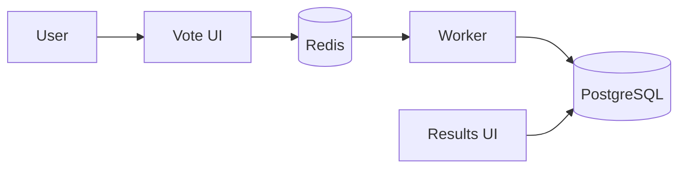

# Voting App — DevOps Capstone 1

A containerized voting application used to practise Docker, Kubernetes on Amazon EKS, Terraform, Helm, and automated container security scanning with GitHub Actions and Trivy.

> **Project status:** Docker Compose testing, EKS deployment, Terraform validation/application, Helm chart validation, and GitHub Actions image build/security-scan workflow have been completed or demonstrated. The Helm chart was validated but its attempted installation did **not** complete successfully because of Kubernetes node pod capacity and NodePort conflicts. Do not treat Helm installation as complete until a successful release is recorded.

## Architecture



The application contains five services:

- **vote** — accepts votes from the user interface.
- **redis** — temporary queue/store for votes.
- **worker** — processes queued votes and writes results to PostgreSQL.
- **db** — PostgreSQL database.
- **result** — displays the vote totals.

## Technology stack

| Area | Technology |
|---|---|
| Source control | Git and GitHub |
| Local containers | Docker and Docker Compose |
| Container registry | Amazon Elastic Container Registry (ECR) |
| Orchestration | Kubernetes on Amazon EKS |
| Infrastructure as Code | Terraform |
| Packaging | Helm |
| CI and image builds | GitHub Actions, Docker Buildx |
| Container security scanning | Trivy |
| Application components | Python, Node.js, .NET, Redis, PostgreSQL |

## Run locally with Docker Compose

Prerequisites: Docker Desktop with the Linux container engine running, Git, and PowerShell on Windows.

From the repository root:

```powershell
docker compose up --build -d
docker compose ps
```

Open the application:

- Vote UI: http://localhost:8080
- Results UI: http://localhost:8081

Useful commands:

```powershell
docker compose logs --tail 100
docker compose logs -f
docker compose down
```

`docker compose down` stops and removes the Compose containers and network. Review the Compose configuration before using volume-removal options because those can delete local data.

## Kubernetes on Amazon EKS

The Kubernetes manifests are in `k8s-specifications/`. They define deployments and services for the vote, result, worker, Redis, and PostgreSQL components.

Check the current cluster and workloads:

```powershell
kubectl get nodes
kubectl get pods -n default -o wide
kubectl get deployments,services -n default
kubectl get events -n default --sort-by=.lastTimestamp
```

Port-forward the UIs from a machine with access to the cluster:

```powershell
kubectl port-forward service/vote 8080:80 -n default
kubectl port-forward service/result 8081:80 -n default
```

Run each port-forward command in a separate terminal. If the service ports differ in the current manifest, inspect `kubectl get service vote result -n default` and use the service's actual port.

The EKS node group was configured with a small instance and limited pod capacity. A second copy of all application pods in another namespace was not schedulable because the single node reached its pod limit. Plan capacity before adding another release; do not deploy a duplicate workload just to demonstrate namespaces.

## Infrastructure as Code — Terraform

Terraform configuration is in `terraform/`.

From the repository root:

```powershell
cd terraform
terraform fmt -check
terraform init
terraform validate
terraform plan
```

Review the plan before applying infrastructure changes. Terraform state and credentials are sensitive and must not be committed. The Terraform directory's `.gitignore` should exclude state files, plan files, and the `.terraform/` directory.

**Cost and security:** AWS EKS, EC2, load balancers, NAT gateways, and related resources can incur charges. Keep the cluster only as long as needed for evidence and learning. Review resources in the AWS Console and the Terraform plan before destroying anything. Never run `terraform destroy` until you have confirmed which resources it will remove and saved all required evidence.

## Helm chart

The chart is under `helm/voting-app/`.

Validate and render it:

```powershell
helm lint .\helm\voting-app
helm template voting-app .\helm\voting-app --namespace voting-helm
```

A server-side dry run can validate rendered Kubernetes resources against a reachable cluster:

```powershell
helm template voting-app .\helm\voting-app --namespace voting-helm |
  Set-Content .\helm-rendered-test.yaml

kubectl apply --dry-run=server -f .\helm-rendered-test.yaml

Remove-Item .\helm-rendered-test.yaml
```

The chart passed lint and server-side dry-run validation during this project. An actual Helm release attempt failed due to NodePort conflicts and node pod capacity; the failed release was uninstalled. Therefore, chart validation is demonstrated, but a successful Helm deployment is not claimed.

## GitHub Actions CI and Trivy

Workflow file: `.github/workflows/ci-trivy.yml`

The workflow builds the `vote`, `result`, and `worker` images with Docker Buildx, scans each image with Trivy, and uploads JSON scan reports as GitHub Actions artifacts.

The successful workflow run used commit `ac9d96e` (`Update Trivy action to v0.36.0`). Download the `trivy-vote-report`, `trivy-result-report`, and `trivy-worker-report` artifacts from the workflow run's **Artifacts** section. Keep the reports with the project evidence.

### Trivy scan results (26 October 2026)

The reports were generated with Trivy `0.70.0`. These are findings from the specific CI image builds, not a guarantee about every image tag or the running EKS workload.

| Image | Base OS detected | Findings | Critical | High | Medium | Low | Unknown |
|---|---|---:|---:|---:|---:|---:|---:|
| `voting-app-vote:ci` | Debian 13.7 | 10 | 0 | 2 | 6 | 2 | 0 |
| `voting-app-result:ci` | Debian 12.11 | 145 | 7 | 52 | 63 | 19 | 4 |
| `voting-app-worker:ci` | Debian 11.9 (end of life) | 161 | 7 | 48 | 59 | 40 | 7 |
| **Total** | — | **316** | **14** | **102** | **128** | **61** | **11** |

The workflow is configured with `exit-code: '0'`, so vulnerability findings do not fail the job. A green workflow means the build-and-scan process completed, **not** that the images are vulnerability-free.

### Security remediation priorities

1. **Worker image — highest priority:** its report identifies Debian 11.9 as end-of-life and includes 7 Critical and 48 High findings across OS and .NET packages. Migrate to a supported .NET runtime/base image compatible with the worker application, update dependencies, rebuild, and rescan.
2. **Result image:** address 7 Critical and 52 High findings across OS and Node.js packages. Update the base image and npm dependencies; validate application compatibility and tests before release.
3. **Vote image:** address the 2 High and 6 Medium findings, including outdated Python packages such as `jaraco.context` and `wheel`, by updating dependencies and rebuilding.
4. Re-run Trivy after changes and review the new JSON reports. Prioritize Critical and High findings, check whether fixes are available, and document any accepted risks.
5. Consider changing the CI policy to fail on Critical/High findings after the images have been remediated, for example with `severity: CRITICAL,HIGH` and `exit-code: '1'`. Introduce this deliberately so the team understands the effect on the pipeline.

## Security and operational notes

- The worker container is configured to run as a non-root user (`10001:10001`).
- `.dockerignore` files reduce unnecessary build context.
- Kubernetes manifests include resource requests and limits.
- Terraform and AWS access should be restricted to the minimum permissions and network ranges required.
- Confirm storage persistence requirements before treating container-local or `emptyDir` data as durable.
- Do not commit AWS credentials, kubeconfig files, Terraform state, `.env` files, tokens, or other secrets.

## Capstone evidence checklist

Capture and retain:

- [ ] Local vote and results pages working.
- [ ] `docker compose ps` showing healthy/running containers.
- [ ] ECR repositories and pushed image tags.
- [ ] EKS node `Ready` and the five application pods running.
- [ ] Terraform validation/plan and infrastructure evidence, with secrets redacted.
- [ ] `helm lint` and Helm template/server-side dry-run output.
- [ ] Green GitHub Actions run and the three Trivy JSON reports.
- [ ] This README committed and pushed to the GitHub repository.
- [ ] A note describing the Helm deployment limitation and Trivy remediation plan.

## Known limitations / next improvements

- The Helm chart has been linted and dry-run validated, but a successful Helm release is still pending.
- The Trivy reports contain unresolved vulnerabilities; the worker image uses an end-of-life Debian base.
- The workflow currently reports vulnerabilities without failing the job.
- The current EKS node capacity is insufficient for an additional full five-service deployment alongside the existing workload.

## Repository

Source: https://github.com/Collins-Nonso/voting-app
