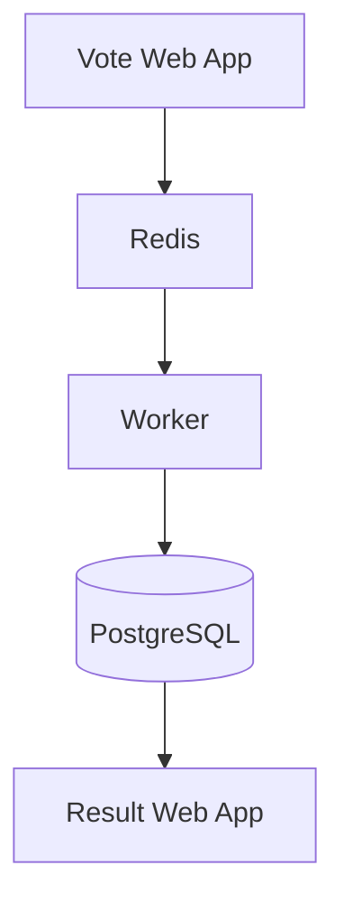

# Example Voting App

A simple distributed application running across multiple Docker containers.

## Getting started

Download [Docker Desktop](https://www.docker.com/products/docker-desktop) for Mac or Windows. [Docker Compose](https://docs.docker.com/compose) will be automatically installed. On Linux, make sure you have the latest version of [Compose](https://docs.docker.com/compose/install/).

This solution uses Python, Node.js, .NET, with Redis for messaging and Postgres for storage.

Run in this directory to build and run the app:

```shell
docker compose up
```

The `vote` app will be running at [http://localhost:8080](http://localhost:8080), and the `results` will be at [http://localhost:8081](http://localhost:8081).

Alternately, if you want to run it on a [Docker Swarm](https://docs.docker.com/engine/swarm/), first make sure you have a swarm. If you don't, run:

```shell
docker swarm init
```

Once you have your swarm, in this directory run:

```shell
docker stack deploy --compose-file docker-stack.yml vote
```

## Run the app in Kubernetes

The folder k8s-specifications contains the YAML specifications of the Voting App's services.

Run the following command to create the deployments and services. Note it will create these resources in your current namespace (`default` if you haven't changed it.)

```shell
kubectl create -f k8s-specifications/
```

The `vote` web app is then available on port 31000 on each host of the cluster, the `result` web app is available on port 31001.

To remove them, run:

```shell
kubectl delete -f k8s-specifications/
```

## Architecture


* A front-end web app in [Python](/vote) which lets you vote between two options
* A [Redis](https://hub.docker.com/_/redis/) which collects new votes
* A [.NET](/worker/) worker which consumes votes and stores them in…
* A [Postgres](https://hub.docker.com/_/postgres/) database backed by a Docker volume
* A [Node.js](/result) web app which shows the results of the voting in real time

## Notes

The voting application only accepts one vote per client browser. It does not register additional votes if a vote has already been submitted from a client.

This isn't an example of a properly architected perfectly designed distributed app... it's just a simple
example of the various types of pieces and languages you might see (queues, persistent data, etc), and how to
deal with them in Docker at a basic level.

---

# DevOps Capstone: Containerized Voting Application

## Project Overview

This project deploys the Example Voting App using Docker, Kubernetes, Amazon EKS, Terraform, Helm, GitHub Actions, and Trivy. It demonstrates containerized application deployment, infrastructure as code, Kubernetes resource management, and automated image vulnerability reporting.

## Architecture

The application contains five components:

- **Vote:** Web interface for submitting votes.
- **Redis:** Temporarily stores votes before processing.
- **Worker:** Transfers votes from Redis to PostgreSQL.
- **PostgreSQL:** Stores processed votes.
- **Result:** Displays the voting results.



## Technology Stack

| Technology | Purpose |
|---|---|
| Docker and Docker Compose | Build and run containers |
| Kubernetes | Orchestrate application workloads |
| Amazon EKS | Managed Kubernetes cluster |
| Amazon ECR | Private container image registry |
| Terraform | Provision AWS infrastructure |
| Helm | Package and validate Kubernetes manifests |
| GitHub Actions | Automate image builds and scanning |
| Trivy | Scan container images for vulnerabilities |

## Run Locally with Docker Compose

Prerequisites: Docker Desktop with its Linux container engine running.

```powershell
docker compose up --build -d
docker compose ps
```

Open the application:

- Vote: http://localhost:8080
- Results: http://localhost:8081

View container logs:

```powershell
docker compose logs --tail=100
```

Stop the local application:

```powershell
docker compose down
```

## Kubernetes Deployment

The `k8s-specifications/` directory contains the Kubernetes Deployment and Service manifests for the application components.

Validate the manifests:

```powershell
kubectl apply --dry-run=client -f .\k8s-specifications\
kubectl get pods
kubectl get services
```

The vote and result Services use NodePort in the standalone Kubernetes manifests. For local access through port forwarding, use separate terminals:

```powershell
kubectl port-forward service/vote 8080:8080
```

```powershell
kubectl port-forward service/result 8081:8081
```

## Infrastructure as Code with Terraform

The `terraform/` directory contains the configuration, variables, outputs, and provider lock file used to provision the EKS infrastructure.

From the repository root:

```powershell
cd .\terraform
terraform init
terraform fmt -check
terraform validate
terraform plan
```

Review the plan before applying changes. Do not run `terraform apply` against an existing environment without understanding the proposed changes.

**Cost and state warning:** EKS, EC2 worker nodes, and related AWS resources can incur charges. Terraform state files may contain sensitive infrastructure information and must not be committed to Git. The configuration's `.gitignore` excludes state files and local Terraform working directories.

When the environment is no longer needed, review the destruction plan carefully before running `terraform destroy`.

## Helm Chart

The chart is located at `helm/voting-app/`.

Validate and render it:

```powershell
helm lint .\helm\voting-app
helm template voting-app .\helm\voting-app --namespace voting-helm
```

Validate rendered resources against the Kubernetes API without creating them:

```powershell
helm template voting-app .\helm\voting-app --namespace voting-helm |
    Set-Content .\helm-rendered-test.yaml -Encoding utf8

kubectl apply --dry-run=server -f .\helm-rendered-test.yaml
Remove-Item .\helm-rendered-test.yaml
```

The chart uses ClusterIP Services for vote and result, avoiding NodePort conflicts with the standalone deployment. A successful lint or dry-run validates the chart structure; it does not by itself prove that a Helm release deployed successfully.

## GitHub Actions and Trivy

The workflow at `.github/workflows/ci-trivy.yml` is configured to run on pushes to `main`, pull requests targeting `main`, and manual dispatch.

For each of the `vote`, `result`, and `worker` components, it:

1. Checks out the repository.
2. Builds the Docker image.
3. Scans the image with Trivy.
4. Uploads a JSON scan report as a GitHub Actions artifact.

The current workflow records findings without failing the job solely because vulnerabilities are detected. Review the JSON reports; a successful scan job does not mean an image is vulnerability-free.

To verify the workflow, open the repository on GitHub, select **Actions**, open the latest workflow run, and inspect the job results and uploaded artifacts.

## Security and Operational Considerations

- The worker image uses a non-root application user.
- `.dockerignore` files help prevent unnecessary files from entering relevant build contexts.
- Kubernetes Deployments specify CPU and memory requests and limits.
- The EKS public API endpoint should remain restricted to trusted IP addresses.
- Do not commit AWS credentials, Terraform state, or other secrets.
- The demonstration database and Redis deployments use `emptyDir` storage. This is ephemeral and is not suitable for durable production data.
- Validate resource capacity before deploying multiple copies of the application on a small Kubernetes node.

## Capstone Evidence Checklist

Capture screenshots or retain command output demonstrating the actual results of:

- [ ] Local vote and results pages working.
- [ ] Kubernetes workloads and Services running.
- [ ] Terraform validation and infrastructure status.
- [ ] Helm lint and server-side dry-run validation.
- [ ] Successful GitHub Actions workflow execution.
- [ ] Trivy JSON reports downloaded from workflow artifacts.
- [ ] README, workflow, Helm chart, Terraform configuration, and Kubernetes manifests committed and pushed.

Only mark an item complete when its result has been verified.
